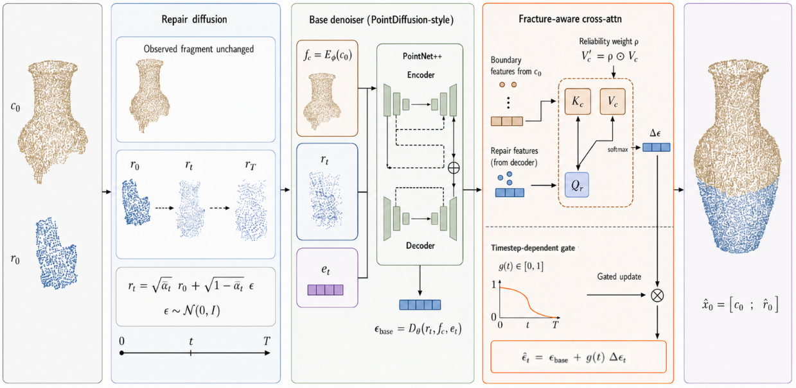
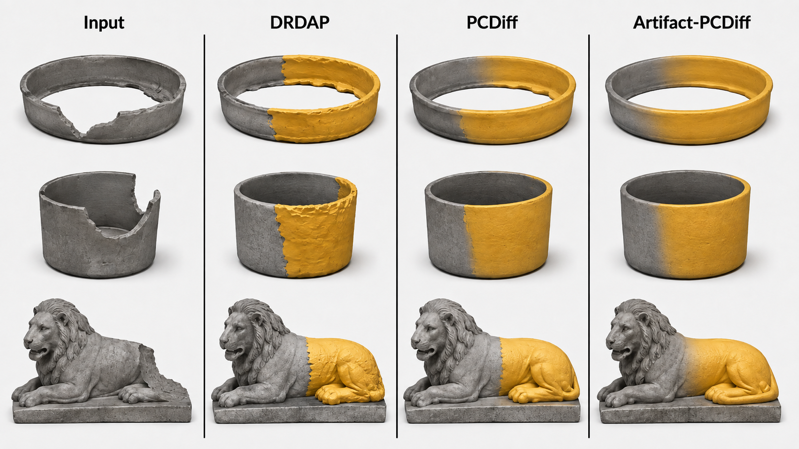

<p align="center">
  
</p>

<p align="center">Missing-region completion of fragmented 3D artifacts</p>

<p align="center">

  
  
  
  <a href="LICENSE"></a>
</p>

Artifact-PCDiff restores missing geometry from partial 3D scans of cultural heritage objects. It combines conditional point-cloud diffusion with fracture-aware refinement so the generated fragment follows the observed boundary.

**Authors:** Nguyen Dinh Hieu, Phan Duy Hung · **Affiliation:** FPT University


<a id="paper"></a>
## Paper

**Artifact-PCDiff: Conditional Point-Cloud Diffusion for Missing-Region Completion of Fragmented 3D Artifacts**
- [Official Paper]()


<a id="method"></a>
## Method

The model keeps the observed fragment as context and learns to generate the missing repair points with a conditional diffusion process. A PVCNN2-style point-cloud backbone extracts geometric features. The fracture-aware refinement uses boundary information and reliability gating to focus updates near the repair interface; an interface loss encourages a coherent join.

The repository implements the training, inference, and artifact-metric paths in `Artifact-PCDiff/Artifact-PCDiff/`.

<a id="qualitative-results"></a>
## Qualitative Results

**Method overview**



**Qualitative comparison**



<a id="dependencies"></a>
## Dependencies

The core dependency manifest lists PyTorch 2.2.1, TorchVision 0.17.1, NumPy below 2, Matplotlib, tqdm, trimesh, Ninja, pynrrd, Open3D 0.17.0, PyMCubes, and SciPy. Optional voxelization packages are listed in [`Artifact-PCDiff/requirements-voxelization.txt`](Artifact-PCDiff/requirements-voxelization.txt); PyTorch3D and `torch-scatter` require separately matched builds.

<a id="downloads"></a>
## Checkpoint and Dataset Downloads

- **Pretrained checkpoint:** [Download `epoch_14999.pth`](https://huggingface.co/datasets/NguyenDinhHieu/Artifact-PCDiff-Data) (original folder: `experiments/train_completion/2025-05-10-20-14-58/checkpoints/`). The evaluator can load legacy PCDiff checkpoints; use a checkpoint trained with Artifact-PCDiff to evaluate the paper method.
- **Precol dataset:** [Download the shared dataset](https://huggingface.co/datasets/NguyenDinhHieu/Artifact-PCDiff-Data). This is the legacy CSV/PLY bundle. The current loader expects complete `.obj` meshes plus matching `broken/<name>_0.npy` and `repair/<name>_0.npy` files. Follow the dataset guide below to assemble or regenerate the runtime layout before training or computing metrics.

<a id="setup"></a>
## Environment Setup

Training and inference require an NVIDIA GPU and CUDA-enabled PyTorch. This repository compiles a custom C++/CUDA extension the first time the model is imported, so install the CUDA Toolkit (`nvcc`) and a compatible C++ compiler as well; the PyTorch wheel alone does not include these build tools. On Windows, install Visual Studio Build Tools with the C++ workload. On Linux or WSL, install `g++`. The reference environment uses Python 3.10, PyTorch 2.2.1, TorchVision 0.17.1, and CUDA 11.8. The [official PyTorch install archive](https://pytorch.org/get-started/previous-versions/) lists the matching `cu118` command.

The extension currently sets `TORCH_CUDA_ARCH_LIST=8.9` in `Artifact-PCDiff/Artifact-PCDiff/modules/functional/backend.py`; the GPU must support compute capability 8.9 unless that setting is changed to match the target GPU.

Create and activate the environment from the repository root in PowerShell:

```powershell
py -3.10 -m venv .venv
.\.venv\Scripts\Activate.ps1
python -m pip install --upgrade pip
```

Install the matching CUDA 11.8 PyTorch pair, then the remaining project dependencies:

```powershell
python -m pip install torch==2.2.1 torchvision==0.17.1 --index-url https://download.pytorch.org/whl/cu118
python -m pip install -r Artifact-PCDiff/requirements.txt
```

Verify the CUDA build before training:

```powershell
python -c "import torch; print(torch.__version__); print(torch.cuda.is_available()); print(torch.cuda.get_device_name(0) if torch.cuda.is_available() else 'CUDA GPU not found')"
```

The core requirements cover training, testing, metric evaluation, and the Precolombian data-generation scripts. For the optional legacy voxelization pipeline, install the general extras after the core requirements:

```powershell
python -m pip install -r Artifact-PCDiff/requirements-voxelization.txt
```

PyTorch3D and `torch-scatter` need builds matching the selected PyTorch, CUDA, and Python versions; install those compatible builds separately before using the voxelization pipeline.

The custom CUDA operations are built when the model imports them. On Linux or WSL, create the environment from the repository root:

```bash
python3.10 -m venv .venv
source .venv/bin/activate
python -m pip install --upgrade pip
python -m pip install torch==2.2.1 torchvision==0.17.1 --index-url https://download.pytorch.org/whl/cu118
python -m pip install -r Artifact-PCDiff/requirements.txt
```

<a id="dataset"></a>
## Dataset Preparation

Keep the generated runtime dataset under `data/precol/`:

```text
data/precol/
├── train.csv
├── test.csv
├── complete/   # Original complete object meshes, such as <name>.obj
├── broken/     # Observed point clouds, <name>_0.npy
└── repair/     # Removed ground-truth fragments, <name>_0.npy
```

Each CSV row points to a complete object. The loader derives the matching `broken/<name>_0.npy` path; training also loads `repair/<name>_0.npy`. Test inference needs the broken point cloud, while metric evaluation needs the repair ground truth.

See [Precolombian-Dataset/README.md](Precolombian-Dataset/README.md) for generation steps and CSV naming. The top-level `.gitignore` excludes `data/`, so dataset files stay local.

<a id="train-and-test"></a>
## Training and Testing

From PowerShell:

```powershell
cd Artifact-PCDiff
.\train.ps1 -BatchSize 8 -Epochs 4000 -Workers 0
.\test.ps1 "path\to\checkpoint.pth" -EvalPath "results\precol" -ComputeMetrics
```

From Linux or WSL, the Bash launchers are also available:

```bash
cd Artifact-PCDiff
bash train.sh
bash test.sh /path/to/checkpoint.pth
```

The test launcher detects the method from checkpoint metadata by default. Use an Artifact-PCDiff checkpoint to evaluate the method described in the paper. `-ComputeMetrics` runs the CDF, HDF, and BCD evaluator after inference; complete repair ground truth must be present for a full test-set report.

<a id="metrics"></a>
## Metrics

CDF, HDF, and BCD are calculated by `Artifact-PCDiff/Artifact-PCDiff/evaluate_artifact_metrics.py` against saved predictions and repair ground truth.

<a id="repository-layout"></a>
## Repository Structure

```text
.
├── Artifact-PCDiff/
│   ├── Artifact-PCDiff/       # Model, dataset loader, train/test and metric code
│   ├── train.ps1 / test.ps1   # Windows launchers
│   └── train.sh / test.sh     # Linux/WSL launchers
├── Precolombian-Dataset/
│   ├── precol/                # Source meshes and generated intermediate files
│   └── scripts/               # Preprocessing and breakage-generation scripts
├── Figures/                   # Paper figures embedded above
├── assets/                    # Project logo
└── data/                      # Local runtime data; ignored by Git
```

<a id="citation"></a>
## Citation

Please cite the paper if this project supports your research:

Citation details will be added when the paper is publicly available.

<a id="license"></a>
## License

This project is released under the [MIT License](LICENSE).
